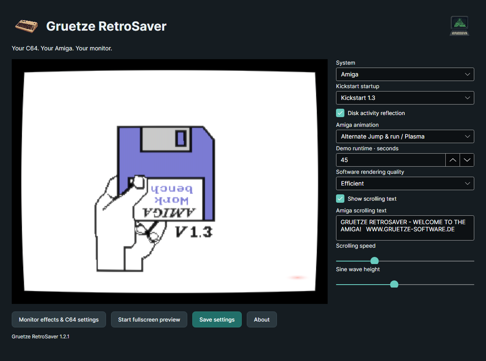
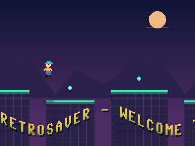
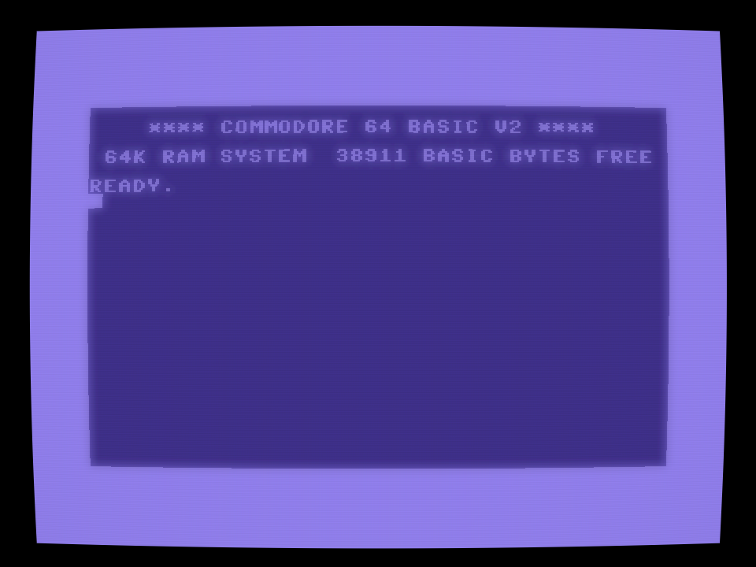
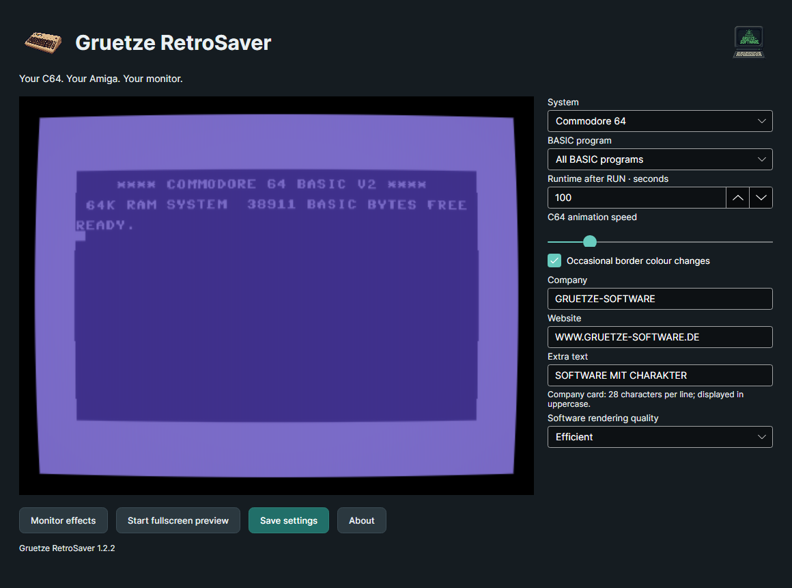
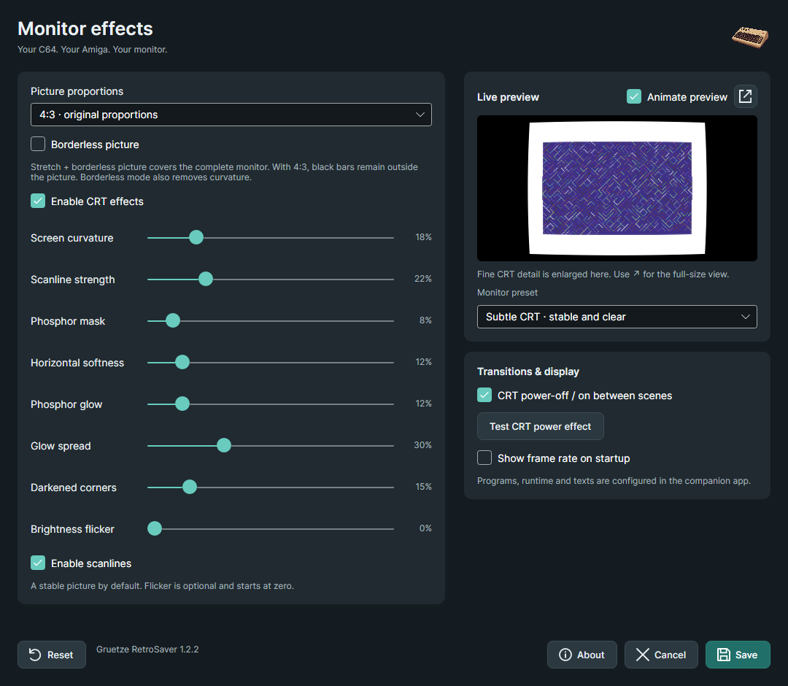

# Gruetze RetroSaver

Version **1.2.1** introduces the .NET 10 / Avalonia 12 companion for C64 and Amiga.
Normal launch opens the companion; --fullscreen starts the selected animation.

The Amiga selection contains **Jump & run** and **Plasma**. Alternate both or repeat
one with a configurable duration and CRT power transitions. Jump & run includes
an automatically jumping explorer, crystals and two independently scrolling woodland
layers. Scrolling text can be edited, adjusted or hidden. Choose the historical
Kickstart 1.3, 2.0 or 3.1 startup, or skip startup; an optional red disk-activity
reflection accompanies loading. No Kickstart ROM is loaded.
See [screen artwork credits](C64Screensaver/Assets/Kickstart/CREDITS.md).

The C64 retains all three BASIC programs, ghost typing, corrections and RUN.
Windows and Linux packages remain free. macOS development builds include the
companion app and a real native system screensaver, built for Apple Silicon and Intel.
A single DMG contains the companion with the native screensaver embedded inside it.
Move the app into Applications, open it, and use **Install / update system screensaver**.
Both interfaces use one per-user settings file; the running screensaver reloads saves
automatically. The native Options dialog remains available. App Store submission is
pending. Mac developer packages are ad-hoc signed, not notarized, and are kept as
build artifacts rather than public release assets.
See [Mac build instructions](macos/README.md) and the
[Developer ID guide](macos/APPLE-DEVELOPER-DE.md).
The downloads below describe the historical C64Screensaver 1.1.0 release.

## Existing C64 release 1.1

A C64-inspired screensaver for Windows, Linux and macOS, built with .NET 10 and Avalonia 12.

The familiar blue startup screen comes to life: an invisible typist enters real
BASIC, makes mistakes, corrects them with Backspace and finally types RUN.
Then the program takes over.

## Features

- Three actual BASIC programs: endless maze, editable company card and twinkling starfield.
- Play one program or cycle through all three, with adjustable run time and repeated code entry.
- CRT curvature, scanlines, RGB phosphor mask, softness, glow, darkened corners and optional flicker.
- Clean pixels, Subtle CRT, Classic monitor and Glowing CRT presets, individual controls and two live preview sizes.
- Optional CRT power-off/on transition, collapsing the image into a line and a glowing point.
- Independent 4:3 or stretched picture proportions and an option to hide the C64 border.
- Editable company name, website and extra message.
- Multiple monitors on Windows and X11; selectable X11/Wayland backend on Linux.

The built-in BASIC interpreter executes a limited C64 BASIC V2 subset. This is
not a full C64 emulator and does not load PRG files. Text uses fixed 8×8 glyphs
on a 40×25 grid without requiring a C64 ROM.

## Download and start

[Download version 1.1.0](https://github.com/gruetze-software/C64Screensaver/releases/tag/v1.1.0)

Version **1.1.0** packages are prepared for Windows, Linux and macOS on x64 and ARM64.
Each ZIP includes the .NET runtime; a separate .NET installation is not required.
Extract the **entire** archive into a folder before launching.

| Platform | Start settings | Start fullscreen |
| --- | --- | --- |
| Windows | c64screensaver.exe --settings | c64screensaver.exe --fullscreen |
| Linux | ./c64screensaver --settings | ./c64screensaver --fullscreen |
| macOS | ./c64screensaver --settings | ./c64screensaver --fullscreen |

On Linux and macOS, first run chmod +x c64screensaver in the extracted folder.
Linux requires a graphical desktop and the native libraries used by Avalonia/Skia;
a minimal server installation is insufficient. macOS packages are unsigned and
not notarized; system security settings may require explicit approval to open them.

Fullscreen exits on mouse movement, click or keypress. Windowed mode closes with
Escape. F toggles frame statistics. Additional commands: --windowed, --about.
On Linux, --x11 and --wayland select the display backend.

### Windows screensaver

The Windows archive includes c64screensaver.scr. Keep it beside the executable
and all included dependencies. Right-click the SCR file for Windows screensaver
options. The standard /s, /c and /p HWND switches are supported.
Do not move the SCR file alone into a system folder.

### Linux and macOS integration

For external automatic-launch options, see the
[Linux and macOS screensaver setup guide](docs/SCREEN-SAVER-SETUP.md).
It includes the current Flathub/Snap Store findings and the distinction between
fullscreen automation and a native macOS screensaver.

On Linux, use --fullscreen through a desktop screensaver command integration
where supported. Wayland currently uses one display; lock-screen integration
depends on the desktop environment.

On macOS, this release is a fullscreen desktop application. A native .saver
bundle and registration in the macOS Screen Saver settings are not included.

Windows rendering and automated tests were checked locally. Linux and macOS
packages are cross-published; native runtime testing on those systems is still
required.

## Settings

### Playback

Select a demo or play all programs in sequence. Run time ranges from 15 seconds
to 30 minutes and starts after RUN. Each reset returns to the blue startup screen,
then types the listing again. Border colours change about every four seconds
rather than flashing constantly.

The company-card text is editable on the right. It is converted to uppercase,
limited to 28 characters per line, and German umlauts become AE, OE and UE.
Save applies changes; Cancel discards unsaved edits.

### Monitor effects

Choose 4:3 for the original picture shape or Stretch to fill the monitor with a
distorted picture. **Hide C64 border** is independent of this choice.
Stretch plus hidden border covers the whole monitor. With 4:3, black bars remain
on wide or portrait displays.

Hiding the border removes outer margins, drift and curvature. A slow brightness
cycle changes even untouched background pixels. Other CRT controls remain
available. Flicker defaults to zero.

The small preview enlarges fine CRT details to make changes visible. The ↗ button
opens a separate, larger live preview with normal detail spacing; F11 toggles
fullscreen there, and Escape closes that preview. Changes update both previews.

Settings are stored in the platform application-data folder under
C64Screensaver/settings.json. Reset restores defaults in the dialog; Save
persists them.

## Build and test

Requires the .NET 10 SDK. Package versions are fixed in the project file.

    dotnet build C64Screensaver.sln -c Release
    dotnet run --project tests/Smoke -c Release

The smoke suite checks BASIC execution, typing and typo correction, RUN gating,
demo rotation, settings persistence, picture coverage and proportions, CRT
transitions, slider geometry and rendered differences in both live previews.
It writes diagnostic images to docs/images.

To deliberately reset the current user's settings and regenerate the two README
screenshots:

    dotnet run --project tests/Smoke -c Release -- --release-screenshots

That explicit command saves a copy of the previous settings in
artifacts/user-settings-before-release.json and writes the default settings.
Ordinary tests do not reset the user's settings.

## Prepare release packages

    pwsh scripts/release.ps1

Builds and tests Release, then creates free Windows/Linux self-contained ZIP files
and a SHA-256 checksum list in artifacts/release/1.2.0.
To publish one platform:

    pwsh scripts/publish.ps1 -Runtime win-x64

Supported targets: win-x64, win-arm64, linux-x64, linux-arm64,
osx-x64, osx-arm64. Internet access may be needed to restore runtime packs.
Publishing does not sign, upload or register the application.

See [release notes](CHANGELOG.md) and
[CRT research and implementation](docs/CRT-RESEARCH.md).

## Credits and license

Created by [Grütze-Software](https://www.gruetze-software.de).
Settings, About styling and the C64 breadbox artwork come from the owner's
GruetzeToaster project. The separate company logo is retained in About.
The renderer uses an original Skia shader; emulator references are documented
in the CRT research notes.

MIT license; see [LICENSE](LICENSE). Independent project, not affiliated with Commodore.

## New in 1.1

Version 1.1 adds smooth CRT bloom with an independent glow-spread
slider and a stable **Glowing CRT** preset. The shader implementation is original.

Automatic activation is delegated to external desktop tools. The application
does not install an idle helper or a login autostart entry.
See [setting up a screensaver on Linux and macOS](docs/SCREEN-SAVER-SETUP.md)
for verified options and platform limitations. The Snap recipe remains an
unbuilt development draft for manually launching the animation.