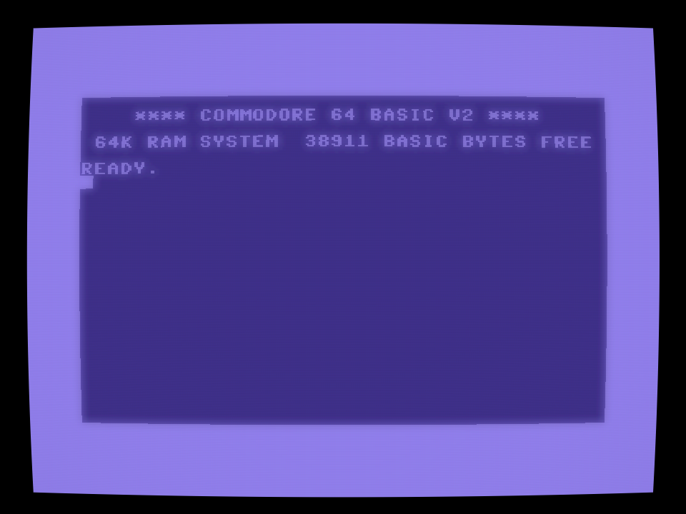
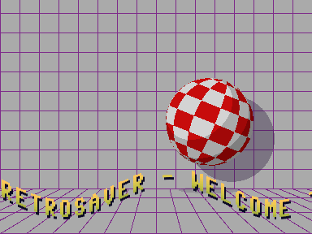
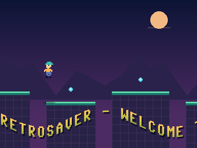
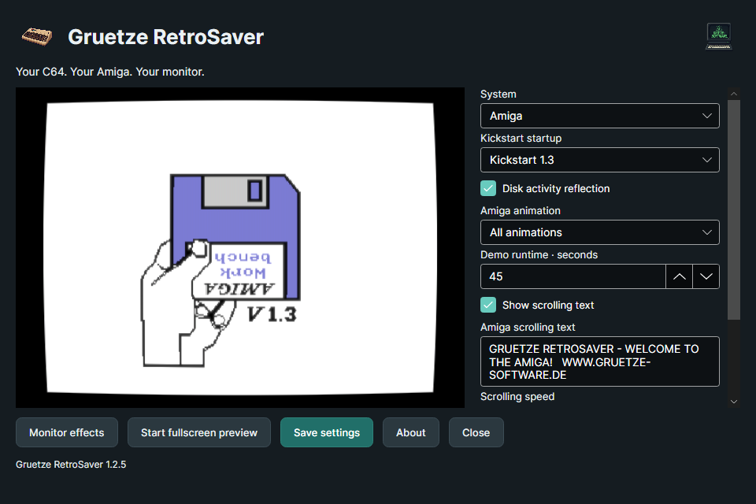
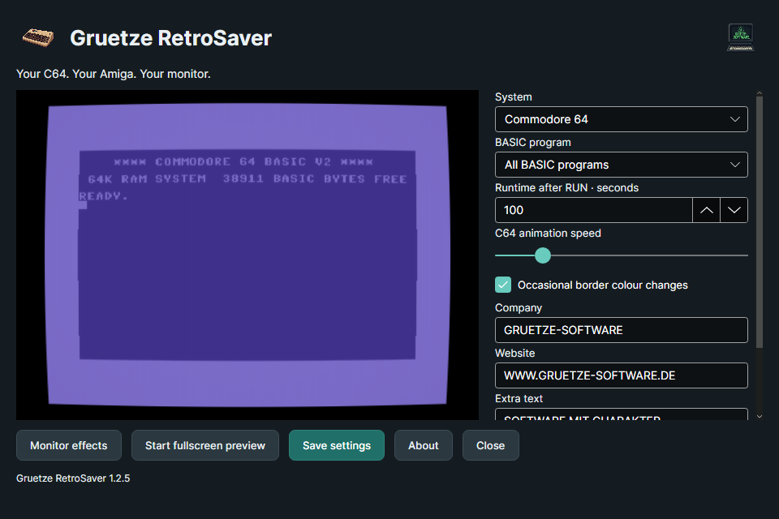
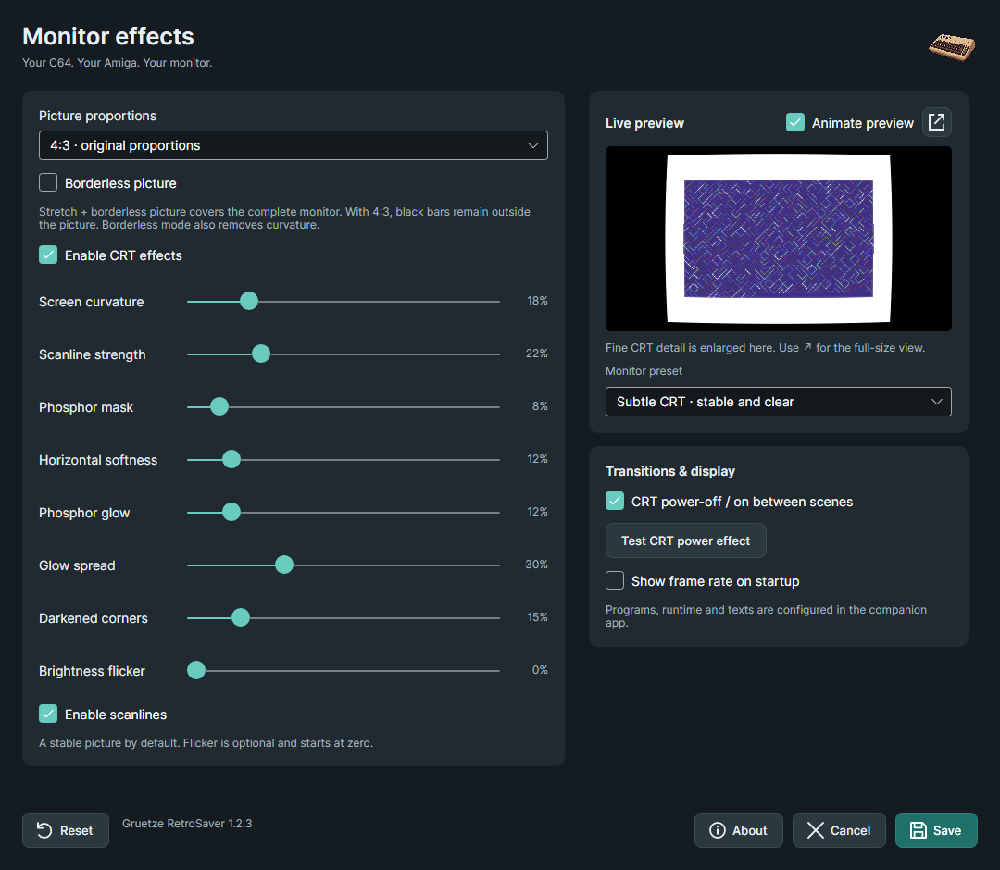

# Gruetze RetroSaver

C64 BASIC and Amiga demo screensavers with a shared companion app and adjustable CRT effects. Built with .NET 10 and Avalonia 12.



## Next version: 1.2.5

Development adds compact dialogs that fit the display's working area, a smaller
preview, an explicit Close button, All Kickstarts rotation and a classic-style
Boing ball. All animations cycles Jump & run, Plasma and Boing. These changes are
not included in the stable 1.2.4 downloads below.



## Two retro worlds

**Commodore 64:** watch an invisible typist enter BASIC line by line, make mistakes,
correct them with Backspace and finally type RUN. Choose an endless maze, an
editable company card or a twinkling starfield. Cycle through all three or repeat
one, with configurable runtime and optional border colour changes.

**Amiga:** choose a Kickstart 1.3, 2.0 or 3.1 startup image, then enjoy an autoplay
Jump & run with layered woodland parallax or colourful Plasma. Alternate both
or repeat your favourite. Edit, adjust or hide the sine-wave scrolling text;
add a subtle disk-activity reflection during startup. No Kickstart ROM is loaded.
See [artwork credits](C64Screensaver/Assets/Kickstart/CREDITS.md).



## Download 1.2.4

[Download Gruetze RetroSaver 1.2.4](https://github.com/gruetze-software/C64Screensaver/releases/tag/v1.2.4)

Free, self-contained ZIP packages are available for **Windows and Linux**, on
x64 and ARM64. No separate .NET installation is needed. Extract the entire ZIP
before starting; keep its files together. Verify downloads with SHA256SUMS.txt.

| Platform | Open companion | Start animation |
| --- | --- | --- |
| Windows | `c64screensaver.exe` | `c64screensaver.exe --fullscreen` |
| Linux | `./c64screensaver` | `./c64screensaver --fullscreen` |

The executable retains its historical filename for compatibility. The application
and download packages are named **Gruetze RetroSaver**.
On Linux, first run `chmod +x c64screensaver`. A graphical desktop and the native
libraries required by Avalonia/Skia are needed. Use `--x11` or `--wayland` to
select the backend; Wayland currently uses one display.

Fullscreen exits on mouse movement, click or keypress after a short launch grace
period. Escape closes windowed previews; F toggles frame statistics.
Additional commands: `--settings`, `--windowed`, `--about`.

### Windows screensaver

Right-click the included `c64screensaver.scr` to install or configure it using
Windows screensaver options. Keep it beside the executable and all dependencies;
do not copy the SCR file alone into a system folder. Standard `/s`, `/c` and
`/p HWND` switches are supported.

### Linux integration

Automatic activation depends on the desktop environment. See the
[setup guide](docs/SCREEN-SAVER-SETUP.md) for X11 and other desktop integrations,
including the limitations on GNOME/Wayland. RetroSaver does not install an idle
helper or autostart entry and does not replace the password lock.

### macOS

A native system screensaver and companion app are in development for Apple
Silicon and Intel. The app contains the `.saver` and offers **Install / update
system screensaver**. Both interfaces share settings; native rendering uses
Metal when available, with a CPU fallback.

Public GitHub releases contain **Windows/Linux downloads only**. Mac distribution
through the App Store is planned; no Store version or purchase link is available
yet. Developer builds and signing are documented in the [Mac guide](macos/README.md)
and [Developer ID instructions](macos/APPLE-DEVELOPER-DE.md).

## Companion and settings

Select C64 or Amiga in the companion. Each system has its own playback and text
controls; settings are saved independently of the shared monitor effects.





**Monitor effects** offers curvature, scanlines, phosphor mask, horizontal
softness, glow strength and spread, darkened corners and optional flicker.
Start from Clean pixels, Subtle CRT, Classic monitor or Glowing CRT, then adjust
each effect with the live preview. The enlarge button opens a bigger preview;
F11 toggles its fullscreen view and Escape closes it.



Choose original 4:3 proportions or stretch to the display. Stretch plus hidden
border fills the monitor; 4:3 retains black bars on wide or portrait displays.
Hiding the border removes curvature. Flicker defaults to zero. Optional CRT
power transitions collapse the image into a line and glowing dot between programs.
Reset in Monitor effects preserves both systems' playback and text settings.

On macOS, Screen Saver Options opens the installed companion, or a native fallback
with General, C64, Amiga and Monitor effects tabs. Move the app to Applications
before installing its embedded screensaver. Mac DMGs include English Read me.txt.

The C64 interpreter implements a limited BASIC V2 subset and a 40×25 character
screen with 8×8 glyphs. This is not a full machine emulator; PRG files are not loaded.

## Build and test

Requires the .NET 10 SDK. Package versions are fixed in the project file.

```sh
dotnet build C64Screensaver.sln -c Release
dotnet run --project tests/Smoke -c Release
```

The smoke suite checks BASIC execution, ghost typing, rotation, settings,
proportions, CRT transitions, live previews and editor layout. It also regenerates
README dialog screenshots using isolated settings, without resetting personal
preferences. Additional Amiga and native bridge tests are in `tests/Amiga` and
`tests/NativeBridge`. Mac CI checks the native options, lifecycle, Metal rendering,
real fullscreen and packaged DMG on Apple Silicon and Intel.

To deliberately reset personal settings and capture defaults, use the optional
`--release-screenshots` smoke argument. Previous settings are backed up in
`artifacts/user-settings-before-release.json`.

## Prepare release packages

```powershell
pwsh scripts/release.ps1
```

Builds and tests Release, then creates Windows/Linux ZIPs and SHA-256 checksums
in `artifacts/release/1.2.4`. Download packages include a short offline guide and
credits; screenshots and Mac developer instructions stay in the repository.
Publish output excludes dependency debug symbols as well as application symbols.
Use `-OutputDirectory artifacts/package-audit/optimized` for separate trial packages.
For one platform use
`pwsh scripts/publish.ps1 -Runtime win-x64`. Public release targets are win-x64,
win-arm64, linux-x64 and linux-arm64. Publishing locally does not upload a release.

See the [changelog](CHANGELOG.md), [CRT research](docs/CRT-RESEARCH.md) and
[Mac performance notes](macos/PERFORMANCE.md).

## Credits and license

Created by [Grütze-Software](https://www.gruetze-software.de).
Settings/About styling and C64 breadbox artwork originate in the owner's
GruetzeToaster project. The company logo appears in About. The CRT shader is an
original implementation; emulator references are documented in the research notes.

MIT license; see [LICENSE](LICENSE). Kickstart captures have separate
[artwork credits](C64Screensaver/Assets/Kickstart/CREDITS.md).
Independent project, not affiliated with Commodore.
