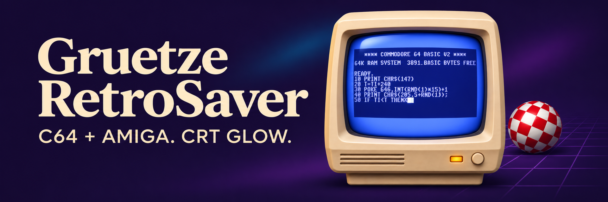
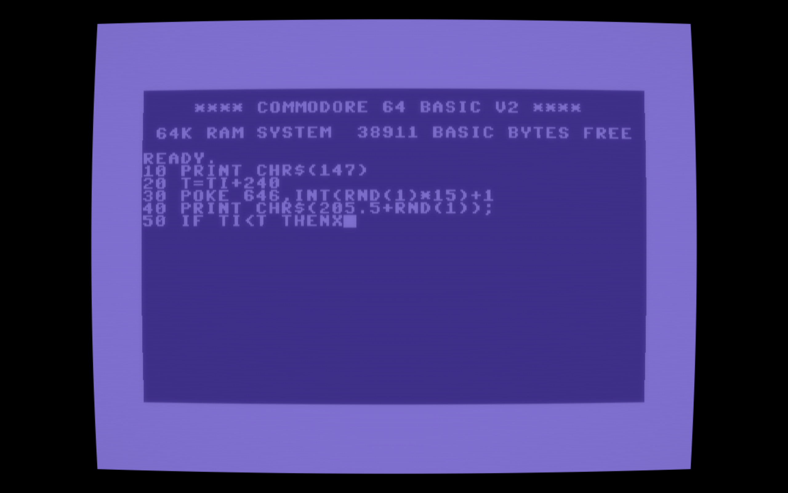
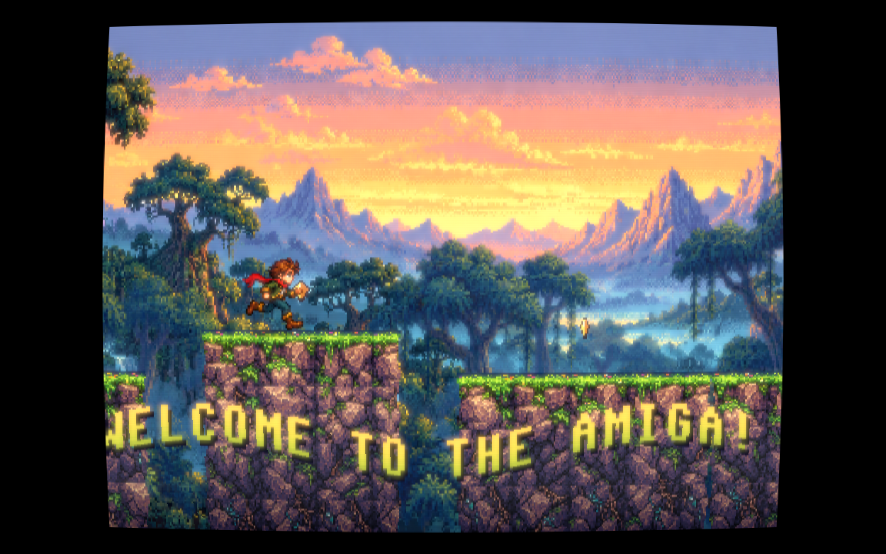
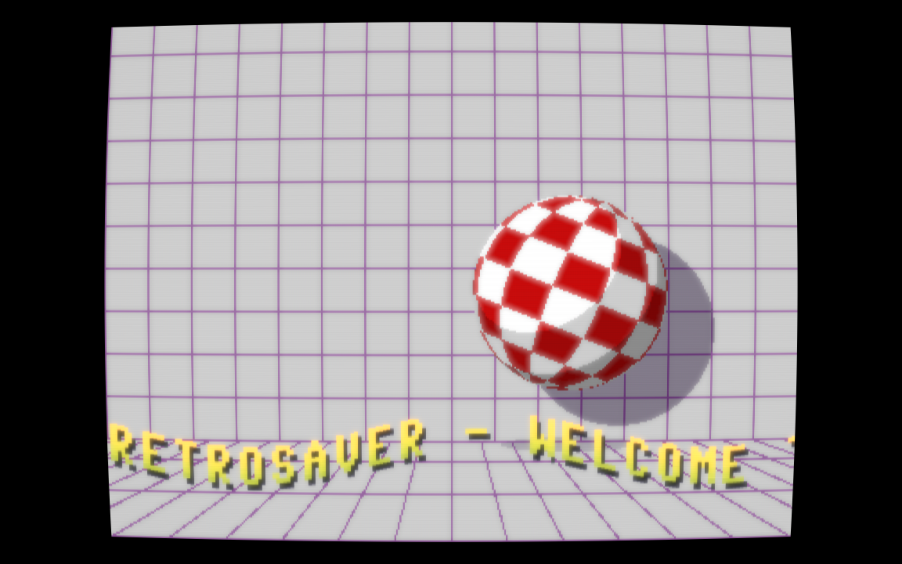
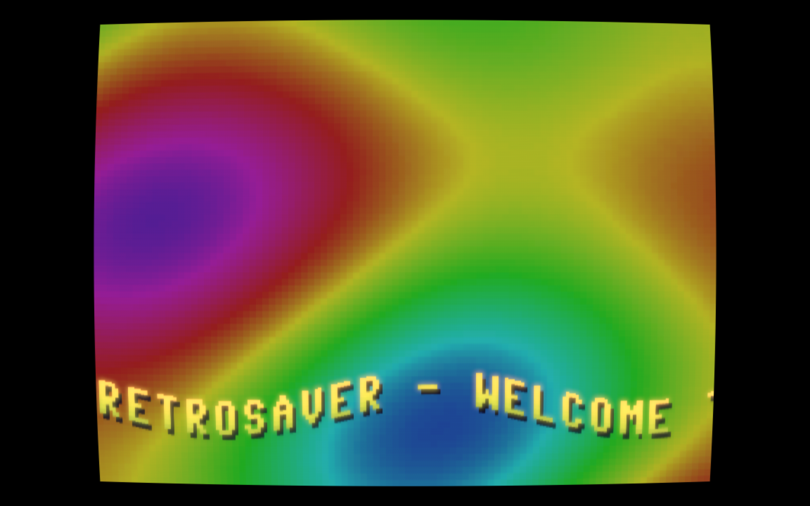
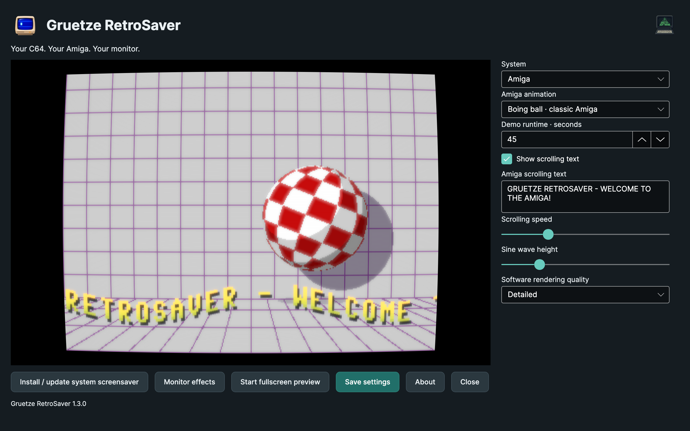
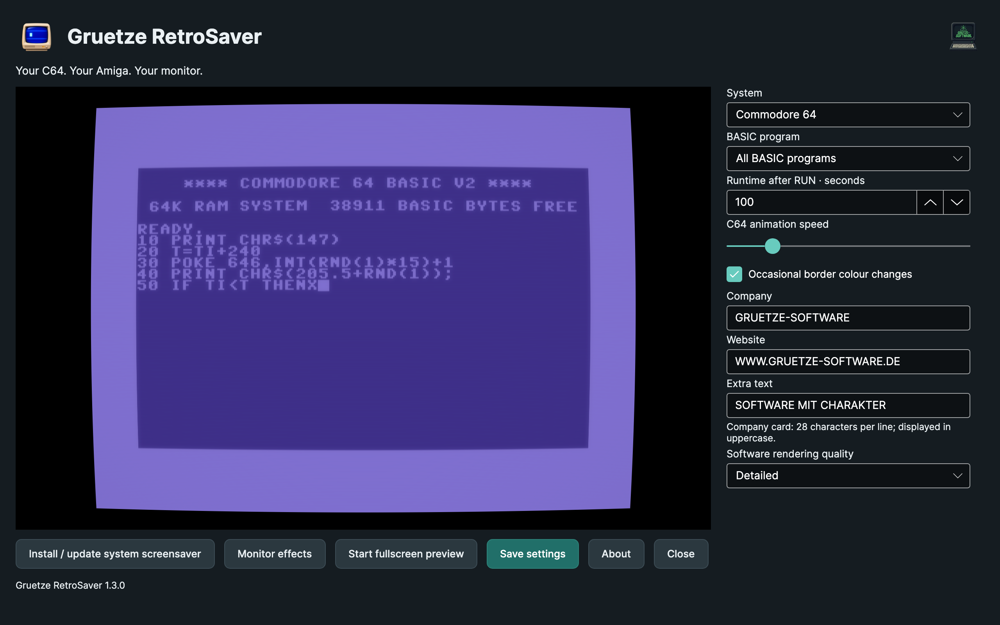
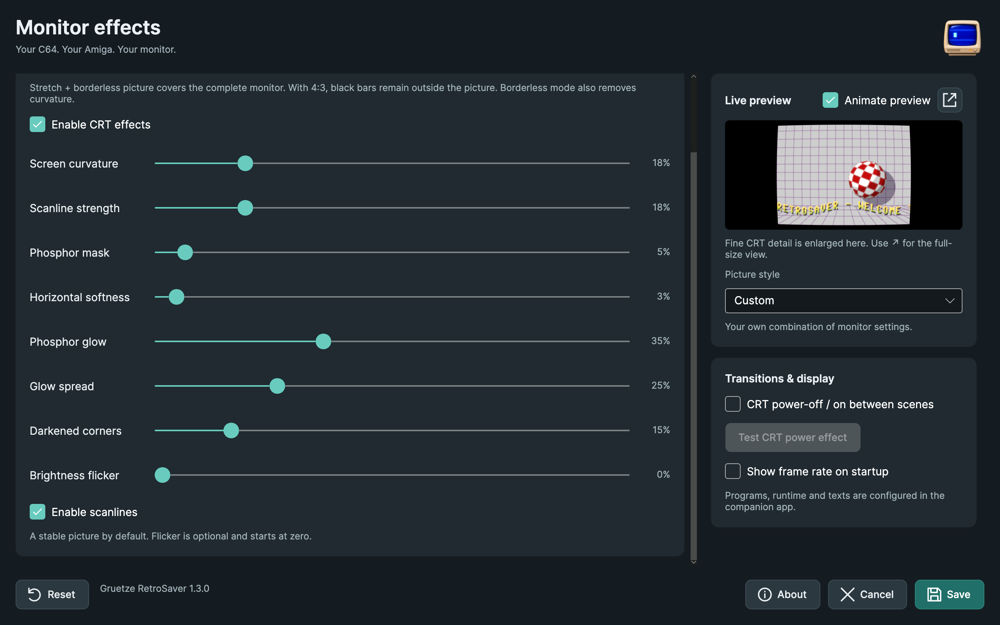

# Gruetze RetroSaver

C64 BASIC and Amiga-inspired animations, a shared companion app and adjustable CRT effects.

<a href="https://apps.apple.com/us/app/gruetze-retrosaver/id6829820538?mt=12"></a>
<a href="https://apps.microsoft.com/detail/9N4KJ5XNRXBJ"></a>

[Free Windows / Linux downloads](https://github.com/gruetze-software/C64Screensaver/releases/latest) · [Linux screensaver setup](docs/LINUX-SCREENSAVER.md)

## Screenshots



| Amiga Jump & run | Classic-style Boing ball |
| --- | --- |
|  |  |
| **Plasma and scrolling text** | **Amiga companion** |
|  |  |
| **C64 companion** | **Shared monitor effects** |
|  |  |

## Two retro worlds

**Commodore 64:** an invisible typist enters BASIC, corrects mistakes and types RUN.
Choose an endless maze, a personalised company card or a twinkling starfield.
Adjust typing speed, runtime and optional border colour changes.

**Amiga:** enjoy an autoplay Jump & run through layered woodland, colourful Plasma
or a red-and-white Boing ball. Cycle through all three and customise the scrolling
message, speed and wave movement. Windows/Linux also offer historical Kickstart
startup screens; the Mac edition starts the animation directly. See the
[artwork credits](C64Screensaver/Assets/Kickstart/CREDITS.md).

**Your monitor:** choose Original, Glow, Classic CRT or Old TV, then adjust glow, scanlines, curvature, phosphor mask, softness and
picture proportions with a live preview. Optional CRT power transitions collapse
the image into a line and glowing dot. Playback and text settings are separate
from the shared monitor effects.

The C64 interpreter implements a limited BASIC V2 subset; it is not a full machine
emulator and does not load PRG files.

## Download and start

### Windows and Linux — free

[Download the Windows / Linux ZIP packages](https://github.com/gruetze-software/C64Screensaver/releases/latest)

Self-contained packages are available for x64 and ARM64. Extract the whole ZIP
into a permanent folder and keep its files together. No separate .NET installation
is required. The Windows edition is also available in the [Microsoft Store](https://apps.microsoft.com/detail/9N4KJ5XNRXBJ). Snap Store packages are being prepared.

| ZIP package | Open companion | Start fullscreen |
| --- | --- | --- |
| Windows | `c64screensaver.exe` | `c64screensaver.exe --fullscreen` |
| Linux | `./c64screensaver` | `./c64screensaver --fullscreen` |

On Linux, first run `chmod +x c64screensaver`. A graphical desktop and the native
Avalonia/Skia libraries are required. Use `--x11` or `--wayland` to select a backend;
Wayland currently uses one display. The executable keeps its historical filename.

For the Snap package, use `gruetze-retrosaver` for settings and
`gruetze-retrosaver.screensaver` for fullscreen animation.

**Windows screensaver:** right-click the ZIP package's `c64screensaver.scr` to
install or configure it. Keep it beside the executable and dependencies. The Store
companion provides an explicit **Install / update system screensaver** button.

**Linux screensaver:** automatic activation depends on the desktop. Follow the
[English Linux setup guide](docs/LINUX-SCREENSAVER.md) for Ubuntu, Linux Mint and other
desktops. RetroSaver does not install an idle watcher or replace the password lock;
the X11 setup does not work on GNOME/Wayland.

Move the mouse, click or press a key to exit fullscreen. Escape closes windowed
previews; F toggles frame statistics. Other commands: `--settings`, `--windowed`, `--about`.

### macOS

<a href="https://apps.apple.com/us/app/gruetze-retrosaver/id6829820538?mt=12"></a>

The companion includes the native system screensaver. Choose C64 or Amiga, save
your settings, then click **Install / update system screensaver** and select it in
macOS Screen Saver settings. The app and saver share settings; the companion asks
for access to the shared settings folder. Native rendering uses Metal when
available, with a CPU fallback.

Public GitHub releases contain Windows/Linux downloads only. For Mac developer
builds and signing, see the [Mac guide](macos/README.md).

## Build and test

Requires the .NET 10 SDK.

```sh
dotnet build C64Screensaver.sln -c Release
dotnet run --project tests/Smoke -c Release
```

See [development and packaging](docs/DEVELOPMENT.md) for release commands and
additional checks, or the [store submission guide](https://github.com/gruetze-software/C64Screensaver/blob/codex/windows-snap-store/store/STORE-GUIDE-DE.md) for
Microsoft Store and Snap packages.

## Credits and license

Created by [Grütze-Software](https://www.gruetze-software.de).
The company logo appears in About. Settings styling originates in the owner's
GruetzeToaster project. The CRT renderer is an original implementation; see the
[research notes](docs/CRT-RESEARCH.md).

[MIT license](LICENSE). Historical Kickstart graphics have separate
[artwork credits](C64Screensaver/Assets/Kickstart/CREDITS.md).
Independent project, not affiliated with Commodore.

[Privacy policy](https://github.com/gruetze-software/C64Screensaver/blob/main/PRIVACY.md) · [Changelog](CHANGELOG.md)
